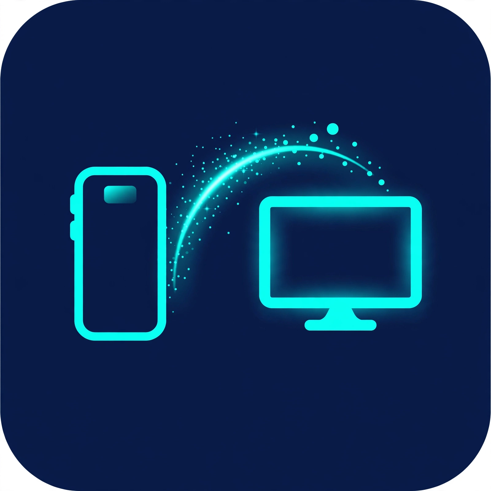

# 📡 Beamo

<p align="center">
  
</p>

<p align="center"><i>Beam files from your phone to your TV — no internet, no cloud.</i></p>

Local-network file sharing — **phone → TV**, phone → phone. Same Wi-Fi or hotspot, no internet, no cloud, no account. Built with Flutter (Android, iOS, Android TV).

## ✨ Features (v1.1)

- **QR pairing** — receiver shows a QR code, sender scans it to connect instantly (no discovery wait)
- **Batch send** — beam multiple files in one go, with per-file progress
- **Live speed + ETA** — transfer tiles show current speed and time remaining
- **Text notes** — send a text snippet; it arrives as a `.txt` file
- **Transfer history** — persistent log of sent/received files
- **Trusted devices** — "Always accept from this device" skips the accept dialog next time
- **Browser upload** — open `http://<receiver-ip>:8080` in any browser to send a file, no app needed
- **Downloads folder** — received files land in the public **Downloads/Beamo** folder (Android), not a hidden app dir

## How it works

```
  ┌──────────┐   mDNS: _beamo._tcp    ┌──────────┐
  │  SENDER  │ ─── discover ───────────▶ │ RECEIVER │
  │ (phone)  │      (or QR scan)         │ (TV)     │
  └──────────┘                           └──────────┘
       │  POST /offer {filename, size, kind, senderId}  │
       │  GET  /offer/<id>/status  (poll)              │  shelf HTTP
       │  POST /upload/<id>  (raw bytes)               │  server :8080
       │  GET  /  → browser upload page                │
       ▼                                               ▼
   progress + speed/ETA              accept dialog → Downloads/Beamo
```

1. **Receiver** (TV): opens *Receive files* → starts an HTTP server on port 8080 and advertises `_beamo._tcp` via mDNS/Bonjour. Can also show a **QR code** for instant pairing.
2. **Sender** (phone): opens *Send files* → browses mDNS (or scans the QR, or enters IP manually), picks files — or sends a **text note**.
3. Each file: `POST /offer` → TV shows **Accept/Decline** (skipped for trusted devices) → sender polls status → on accept, raw bytes stream via `POST /upload/<id>` with progress, speed and ETA on both sides.
4. Text offers carry their payload inside the offer — no upload step; the receiver saves them as `.txt`.
5. Any browser on the same network can open `http://<receiver-ip>:8080` and send a file through the same offer flow.

## Project structure

```
lib/
  main.dart
  models/
    peer_device.dart      # discovered device (name, host, port)
    transfer.dart         # transfer state (progress, speed, ETA, kind)
  services/
    network_service.dart  # Wi-Fi IP lookup
    discovery_service.dart# mDNS advertise + browse (nsd)
    share_server.dart     # shelf HTTP server: offer/upload/text/browser page (receiver)
    share_client.dart     # HTTP client: offer → poll → upload, text send (sender)
    storage_service.dart  # staging dir + public Downloads move (MediaStore)
    trusted_service.dart  # trusted device IDs (auto-accept)
    history_service.dart  # persistent transfer history
  screens/
    home_screen.dart      # Send / Receive role picker + history entry
    send_screen.dart      # pick files, QR scan, text notes, batch send
    receive_screen.dart   # advertise, pairing QR, accept dialog, progress
    qr_scan_screen.dart   # camera QR scanner
    history_screen.dart   # transfer history + trusted devices
  widgets/
    transfer_tile.dart    # progress row (speed + ETA)
    radar_pulse.dart      # receiver beacon animation
    file_type_helper.dart # file-type icons
android/app/src/main/kotlin/.../MainActivity.kt  # MethodChannel: save to public Downloads
```

## Setup

```bash
# 1. scaffold the native projects, then drop these files in
flutter create --org com.example --project-name beamo beamo-app
# copy pubspec.yaml + lib/ from this folder into beamo-app/

cd beamo-app
flutter pub get
flutter run
```

### App icon

The logo lives at `assets/icon/app_icon.png`. Generate all platform icons with:

```bash
dart run flutter_launcher_icons
```

> `flutter create` generates `android/` and `ios/` for you — this repo ships the Dart side (`lib/`, `pubspec.yaml`) which is where all the logic lives.

### Android — `android/app/src/main/AndroidManifest.xml`

```xml
<uses-permission android:name="android.permission.INTERNET" />
<uses-permission android:name="android.permission.ACCESS_NETWORK_STATE" />
<uses-permission android:name="android.permission.ACCESS_WIFI_STATE" />
<uses-permission android:name="android.permission.CHANGE_WIFI_MULTICAST_STATE" />
<!-- needed for getWifiIP() on Android 10+ -->
<uses-permission android:name="android.permission.ACCESS_FINE_LOCATION" />
<!-- QR code scanning -->
<uses-permission android:name="android.permission.CAMERA" />
<!-- public Downloads fallback on Android 9 and below (MediaStore needs none on 10+) -->
<uses-permission android:name="android.permission.WRITE_EXTERNAL_STORAGE" android:maxSdkVersion="28" />
```

### iOS — `ios/Runner/Info.plist`

```xml
<key>NSLocalNetworkUsageDescription</key>
<string>Beamo needs local network access to find nearby devices.</string>
<key>NSBonjourServices</key>
<array>
  <string>_beamo._tcp</string>
</array>
<key>NSCameraUsageDescription</key>
<string>Beamo uses the camera to scan pairing QR codes.</string>
```

## 📺 Android TV notes

- Build an APK (`flutter build apk`) and sideload it on the TV.
- Open **Receive files** on the TV — the Accept button is autofocused for D-pad remotes.
- For a proper TV launcher entry, add to the manifest:
  ```xml
  <uses-feature android:name="android.software.leanback" android:required="false" />
  ```
  and an `android:banner` on the launcher activity (optional).
- Received files land in the public **Downloads/Beamo** folder — visible in the TV's file manager and gallery apps.

## 📶 Hotspot tips

- Phone hotspot ON → TV joins the hotspot → same LAN, works.
- Some hotspots block mDNS multicast: if the TV doesn't appear, **scan the receiver's QR** or use **Manual IP** on the sender (the TV shows its IP on the Receive screen).
- iOS Personal Hotspot + Android TV: same deal — QR / manual IP is the reliable fallback.

## Limitations / roadmap

- [x] Batch send (sequential, one at a time per peer)
- [x] Browser upload without the app
- [ ] No resume after disconnect — large files restart
- [ ] Receiver can't browse the sender's files (push-only for now)
- [ ] No transfer encryption — LAN-only, don't use on untrusted networks
- [ ] iOS background uploads will pause if the app is backgrounded
- [ ] TV D-pad: basic focus works; full leanback polish is future work

## Dependencies

`nsd` (mDNS) · `shelf` + `shelf_router` (embedded server) · `http` · `file_picker` · `path_provider` · `permission_handler` · `network_info_plus` · `uuid` · `qr_flutter` (pairing QR) · `mobile_scanner` (QR scan) · `shared_preferences` (history + trusted devices)
